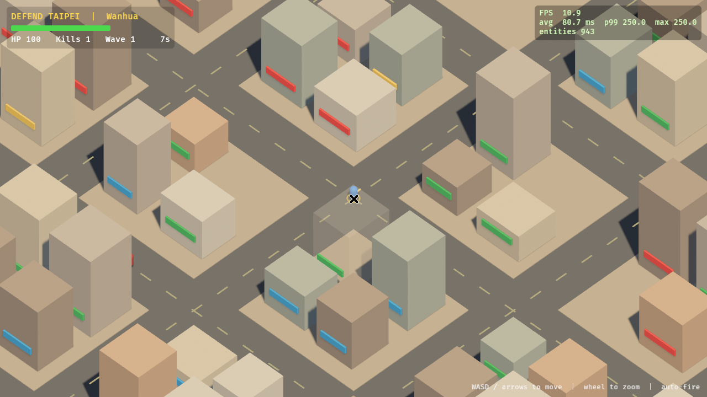
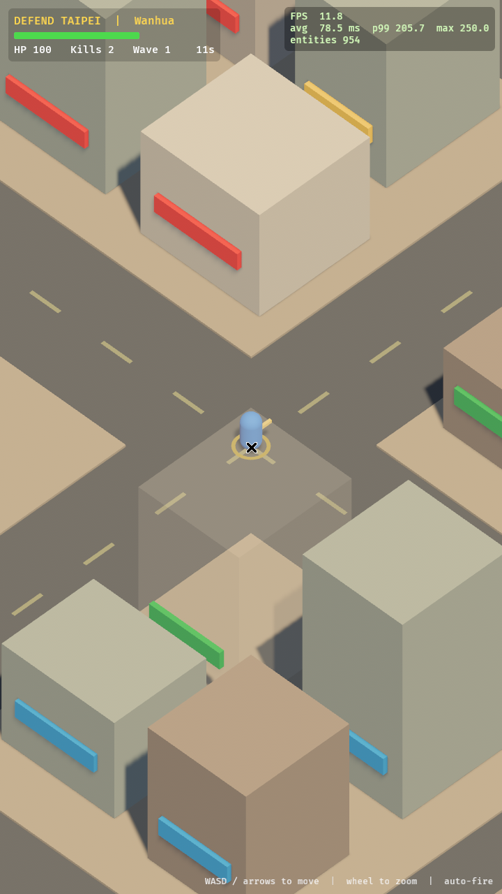

# DefendTaipei-Android

Native Android (and desktop) version of [Defend Taipei](https://github.com/lijiabao1998/defendtaipei), a Taipei urban survival game, rewritten in **Rust + [Bevy](https://bevy.org) 0.20.1**.

The original game is a TypeScript + Three.js web title (currently v24.42) set across Taipei's 12 districts. This repo is the native port: the same Rust code builds a desktop executable and an Android APK.

## Status: first playable slice (v0.1.0)

| Landscape | Portrait |
| --- | --- |
|  |  |

What you can do right now:

- Walk a placeholder **Wanhua street grid** (box buildings with shop signs, sidewalks, lane markings) with building collision.
- **Isometric orthographic camera** matching the web build: offset (40, 56, 40), ~44 m of street visible in landscape, tighter framing in portrait, zoom 0.5×–2.2×. Buildings between the camera and the player turn see-through.
- **Survive waves**: hostiles close in from outside the view; you auto-fire at the nearest one within 15 m. Contact drains HP; every 25 s the wave number goes up (more, faster, tougher hostiles). Game over shows your time, kills and wave; tap / press R to retry.
- **Controls**
  - Desktop: WASD or arrow keys to move, mouse wheel to zoom.
  - Phone: touch the left part of the screen and drag for a floating virtual joystick; pinch with two fingers to zoom.
- **Orientation**: landscape is the main layout; portrait works too. The Android activity follows the sensor, and the camera and HUD re-fit on every resize / rotation (resize the desktop window to test).
- **Perf overlay** (top-right): FPS, avg / p99 / max frame time, entity count. Off by default in release builds; on in debug. Toggle with **F3** (desktop) or a **three-finger tap** (Android). Force with `DEFEND_TAIPEI_PERF=1`. A `DTPERF …` line is always printed to stdout / logcat every ~5 s for CI.

Everything is placeholder geometry: no models, textures, audio, menus or story yet.

## Get the APK (no build needed)

Every push and pull request runs [GitHub Actions](../../actions/workflows/ci.yml). Open the latest successful run → **Artifacts** → `DefendTaipei-arm64-debug-apk`, download the zip, unzip it, and install `DefendTaipei-arm64-debug.apk` on the phone (allow "install unknown apps" for your browser / file manager).

Requirements: a 64-bit ARM phone (arm64-v8a) with **Android 12 (API 31) or newer** and Vulkan support. The APK is debug-signed (fine for testing, not for the Play Store).

## Project layout

```
Cargo.toml            workspace (Bevy 0.20.1, shared profiles and lints)
game/                 crate `defend_taipei`: all gameplay + desktop binary `defend-taipei`
  src/lib.rs          app setup (window, plugins) — `defend_taipei::run()`
  src/city.rs         Wanhua placeholder grid, building footprints
  src/player.rs       player, keyboard input, collision
  src/camera.rs       isometric follow camera, zoom, resize/orientation fit, occluder fading
  src/touch.rs        floating virtual joystick + pinch zoom
  src/combat.rs       waves, hostiles, auto-fire, HP, restart
  src/hud.rs          HP bar, stats, game-over banner
  src/chunk/          256 m tile streaming, near/mid/far LOD, mesh chunking, vertex compact (off until a map provider enables it)
  src/perf.rs         FPS overlay + DTPERF log lines (CI smoke)
mobile/               crate `defend_taipei_android`: cdylib with `#[bevy_main]` (GameActivity entry)
android/              Gradle project (from Bevy's examples/mobile/android_example), GameActivity
.github/workflows/    CI: desktop fmt/clippy/build + arm64 APK artifact
```

## Build and run on desktop

Needs Rust **1.97.1 or newer** (`rustup update stable`).

```sh
# Linux only: system libraries for audio, input and windowing
sudo apt-get install libasound2-dev libudev-dev libwayland-dev libxkbcommon-dev pkg-config

cargo run -p defend_taipei            # debug (dependencies are optimized, first build takes a while)
cargo run -p defend_taipei --release  # smoother
```

Windows and macOS need no extra system packages.

## Build the Android APK locally

Follows Bevy 0.20.1's official Android path ([docs](https://github.com/bevyengine/bevy/blob/v0.20.1/examples/README.md#android)): `cargo-ndk` builds the Rust library, Gradle packages it with GameActivity. (`cargo-apk` is deprecated and does not support GameActivity.)

Prerequisites: Android SDK (platform 34, build-tools), Android NDK (tested with r27), JDK 17+.

```sh
rustup target add aarch64-linux-android
cargo install cargo-ndk
export ANDROID_HOME=$HOME/Android/Sdk
export ANDROID_NDK_HOME=$ANDROID_HOME/ndk/<version>

# 1. Rust → android/app/src/main/jniLibs/arm64-v8a/libdefend_taipei_android.so
cargo ndk -t arm64-v8a -P 31 -o android/app/src/main/jniLibs build --release -p defend_taipei_android

# 2. Package and (optionally) install
cd android
./gradlew assembleDebug        # → app/build/outputs/apk/debug/app-debug.apk
./gradlew installDebug         # with a phone connected over adb
```

Use `--release` for the Rust step: a debug `.so` with symbols is over 2 GB.

## Tech notes

- **Engine:** Bevy 0.20.1 (ECS). Rendering via wgpu on **Vulkan** on Android.
- **Android:** GameActivity (`androidx.games:games-activity` 4.4.0, matching Bevy's `android-activity`), `minSdk 31`, `arm64-v8a` only, `screenOrientation="sensor"`. MSAA and shadow maps are disabled on Android (known Bevy crashes on some GPUs, bevyengine/bevy#8229 and #8214).
- **Desktop:** Windows, Linux and macOS from the same code.

## Known gaps / next steps

- Not yet tested on a physical phone; first device run may surface GPU/driver issues.
- No title screen, pause on app background, audio, or Chinese text (Bevy's default font has no CJK glyphs; needs a bundled font).
- Placeholder map, not the real Wanhua street layout; no AI teammates, weapons choice, or districts from the web build.
- APK is ~45 MB (debug-signed); Bevy feature trimming and a signed release build come later.
